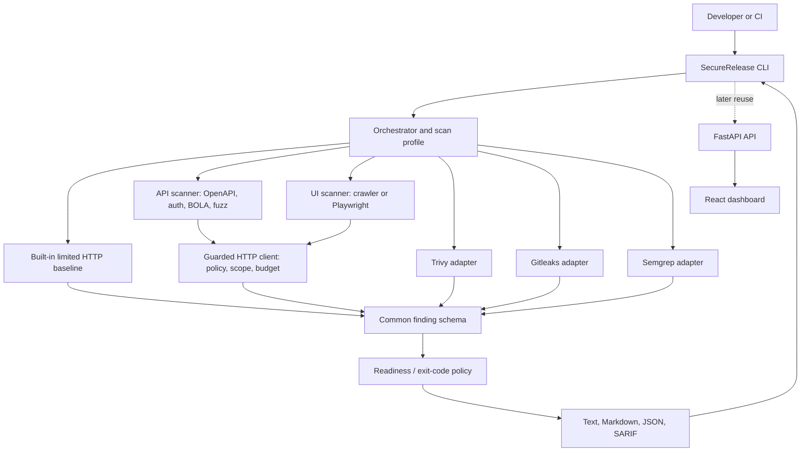

# SecureRelease Architecture and Roadmap

## Architecture

## Design boundaries

- The CLI and core should own scan orchestration, normalized findings, evidence presentation, policy, and report generation.
- Scanner adapters should own invocation and output parsing for third-party scanners.
- Native checks should be small and testable, not a replacement for mature SAST/DAST/SCA engines.
- The dashboard should consume the common data model rather than parse individual scanners directly.
- `NOT_TESTED` and `ERROR` are not passes. CI must not silently pass when a required engine is missing.

## Current implementation (v0.1)

- Installable Python CLI named `securerelease`.
- Native limited HTTP baseline for HTTPS scheme, selected response headers, cookie attributes observed on the response, technology-disclosure headers, HTTP status, and a limited CORS observation.
- Optional Trivy, Gitleaks, and Semgrep subprocess adapters, and an optional Docker-based OWASP ZAP adapter (`dast` profile).
- Native API scanner (`--profile api`, `api-scan`): OpenAPI 3.x/Swagger 2.0 import with coverage accounting, per-endpoint passive checks, unauthenticated-access check, authenticated scan, BOLA/IDOR replay between two users, bounded fuzzing and a rate-limit probe.
- Native UI scanner (`--profile ui`, `ui-scan`): same-origin crawler or optional Playwright engine; shared analyzers for headers/CSP, cookies, mixed content, forms, SRI, secrets, storage, source maps and exposed paths; authenticated via storage state, header/cookie or scripted login.
- Both scanners use one guarded HTTP client (`safe_http.py`): target policy on every origin, same-origin enforcement, request budget, capped bodies, no automatic redirects, mutating methods off by default, credentials from environment variables only and redacted from output.
- Two safety tiers: a passive default, and an active tier (BOLA replay, fuzzing, rate-limit burst, reflection/open-redirect probes) that requires `--authorized`.
- Common finding schema and JSON/Markdown/SARIF export.
- Severity-based command exit behavior.
- Initial tests for the finding model, report serialization, safe target validation, and CI policy.

Not implemented yet: multi-step login/MFA flows, role-matrix authorization tests, mutating-endpoint authorization tests, Git-history secret scanning, cloud inventory, container registry scanning, AI/LLM-specific probes, dashboard, long-running server, persistent scan database, organization/authentication, or complete SSRF protections for hosted multi-tenant use.

## Development phases and exit criteria

### Phase 1 — Reliable CLI foundation
- Finish unit and integration tests; test each adapter against pinned scanner versions and fixtures.
- Add a test fixture repository containing known-safe and intentionally vulnerable patterns.
- Verify secret values never appear in reports or logs.
- Keep scanner process execution bounded and report tool failures distinctly.

Exit: reproducible local install, stable JSON schema, tests pass in CI, and scanner absence cannot masquerade as a clean repository scan.

### Phase 2 — DAST and API specifications
- Add optional ZAP adapter and safe baseline profile.
- Add OpenAPI import and endpoint coverage reporting.
- Add explicit authorization scope and test-environment checks before any active scan.

Exit: intentionally vulnerable staging fixtures are detected with traceable evidence, and scans stay within the approved scope.

### Phase 3 — Readiness mapping
- Map check IDs and scanner results to a versioned control catalog.
- Track evidence coverage, engine errors, exceptions, accepted risks, and expiry.
- Introduce configurable policy profiles instead of a universal security score.

Exit: the report clearly separates PASS, WARN, FAIL, NOT_TESTED, ERROR, and accepted risk, and a policy test suite verifies every release decision.

### Phase 4 — CI/CD and distribution
- Publish signed/versioned packages and pin scanner versions where possible.
- Provide GitHub Actions, GitLab CI, and Jenkins examples.
- Add repeatable JSON and SARIF artifacts and explicit exit-code behavior.

Exit: the same core workflow works locally and in at least two different CI systems.

### Phase 5 — Product validation and optional dashboard
- Pilot with several small engineering teams.
- Track time to understand findings, actionable finding rate, repeat usage, missed findings in benchmark fixtures, and coverage gaps.
- Add the React/FastAPI dashboard only if teams need central history, collaboration, or policy management.

Exit: teams use it repeatedly and can name a concrete workflow improvement versus current tools.

### Phase 6 — AI security and update lifecycle
- Integrate a dedicated AI testing framework after core profiles are stable.
- Add AI-specific assessments for prompt injection, RAG access controls, sensitive-data exposure, and agent tool permissions, using controlled test environments.
- Version and test rule updates before distributing them; use human review for novel active tests.

Exit: AI tests have repeatable fixtures, bounded execution, no production-side effects by default, and clear limitations.
